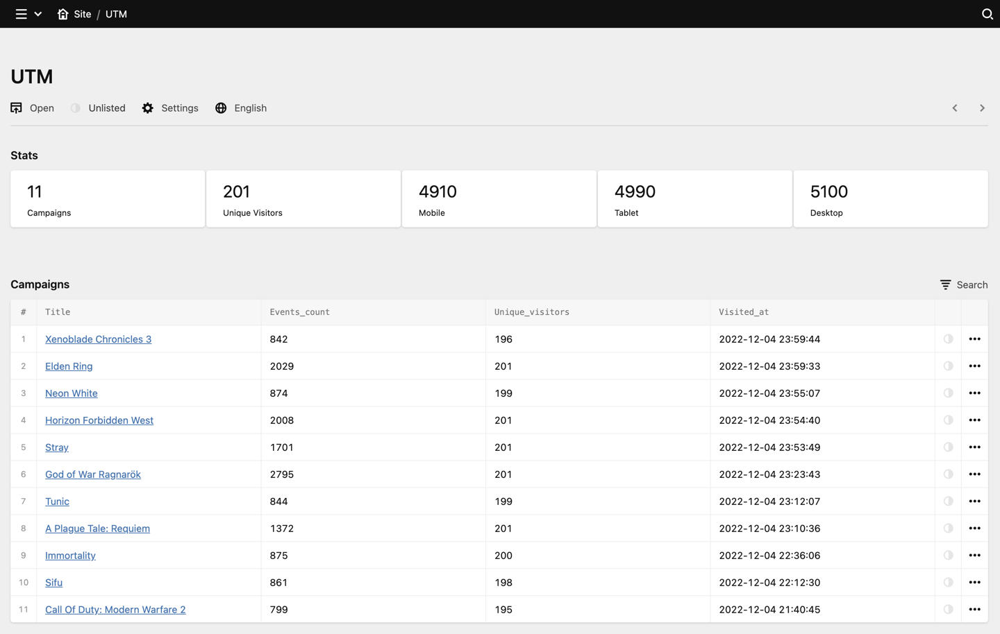
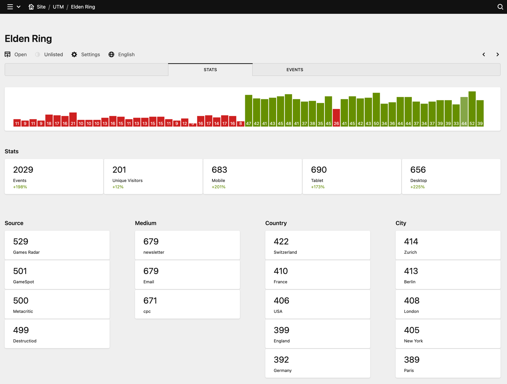

# Kirby UTM

[](https://getkirby.com/releases/6)


[](https://github.com/bnomei/kirby3-utm/actions/workflows/pest-tests.yml)
[](https://codeclimate.com/github/bnomei/kirby3-utm/issues)
[](https://discordapp.com/users/bnomei)
[](https://www.buymeacoffee.com/bnomei)

## Installation

Version 6 requires Kirby 6 and PHP with SQLite3 and PDO SQLite. Use version 5 for Kirby 5; the two Panel builds are not interchangeable.

- unzip [main.zip](https://github.com/bnomei/kirby3-utm/archive/refs/heads/main.zip) as folder `site/plugins/kirby3-utm` or
- `git submodule add https://github.com/bnomei/kirby3-utm.git site/plugins/kirby3-utm` or
- `composer require bnomei/kirby3-utm`

## Usage

### UTM Page

Create a new page at root level with the blueprint `utm`.


<br>


### Tracking

Events will automatically be tracked to a sqlite database and appear in the UTM page within the panel grouped by campaign and displaying multiple stats.

## UTM

Original UTM explanation from [Bonnie Kittle at cdgi.com](https://www.cdgi.com/2020/04/how-to-use-utm-codes-to-track-campaigns-in-google-analytics/).

### utm_source

The advertiser, site, publication, etc. that is sending traffic to your property

### utm_medium

The advertising or marketing medium, for example, CPC (cost-per-click), banner ad, email newsletter

### utm_campaign

The individual campaign name, slogan, promo code, etc.

### utm_term

Identify paid search keywords. If you’re manually tagging paid keyword campaigns, you should also use utm_term to specify the keyword.

### utm_content

Used to differentiate similar content or links within the same ad. For example, if you have two call-to-action links within the same email message, you can use utm_content and set different values for each so you can tell which version is more effective. (i.e. image, button, headline)

## Cache

> [!WARNING]
> If **global** debug mode is `true,` the plugin will flush its cache and not write any more caches.

For best performance, set either the [global or plugin-specific cache driver](https://getkirby.com/docs/reference/system/options/cache) to one using the server's memory, not the default using files on the hard disk (even on SSDs). If available, I suggest Redis/APCu or leave it at `file` otherwise.

**site/config/config.php**
```php
return [
  'cache' => [
    'driver' => 'apcu', // or redis
  ],
  'bnomei.utm.cache.ipstack' => [
    'type' => 'apcu', // or redis
  ],
  'bnomei.utm.cache.ratelimit' => [
    'type' => 'apcu', // or redis
  ],
  'bnomei.utm.cache.queries' => [
    'type' => 'apcu', // or redis
  ],
];
```

## Settings

| bnomei.utm.        | Default | Description                                                                                |
|--------------------|---------|--------------------------------------------------------------------------------------------|
| enabled            | `true`  |                                                                                            |
| cache.ipstack      | `true`  | separate cache for ip data, expires at `ipstack.expire`                                    |
| cache.ratelimit    | `true`  | separate cache for ratelimit, expires at `ratelimit.expire`                                |
| cache.queries      | `true`  | separate cache for most queries used in panel, flushes automatically with each event tracked |
| ipstack.access_key | `null`  | string. access key                                                                         |
| ipstack.allowInsecureHttp | `false` | boolean. if `true`, ipstack lookups use cleartext HTTP. Keep disabled unless your account cannot use HTTPS. |
| ipstack.expire     | `60*24` | int. cache in minutes for ipstack IP resolution.                                           |
| sqlite.file        | `fn()`  | path to sqlite file. like site/logs                                                        |
| stats.range        | `30`    | int. half of range of days for bar and change percentage                                   |
| ratelimit.enabled  | `true`  | bool. if `true` it will limit on params below                                              |
| ratelimit.expire   | `60`    | int. in minutes before trials reset                                                        |
| ratelimit.trials   | `120`   | int. number of allowed trials in given duration                                            |
| botDetection.CrawlerDetect   | `true`  | check for crawlers (~10ms)                                                        |
| botDetection.DeviceDetector   | `true`  | check for bots (~40ms)                                                                     |

## Dependencies

- (optional) [free ipstack account for IP geolocations](https://ipstack.com/)

## Testing the Panel

In an Amp orb, `.agents/setup` prepares PHP, the locked Kirby test site and Chromium. Run `npm run test:panel` to track a visit, sign into the real Panel, and check the campaign chart and read-only event details. The test creates its own account, cache and SQLite database and removes them afterwards.

Elsewhere, use PHP 8.4 and Node 24+, then run `composer kirby`, `npm ci` and `npx playwright-core install chromium` (or set `CHROME_BIN` to an installed Chrome). Run `npm run build` after changing the Vue field. `composer test` runs the PHP suite and `composer stan` runs static analysis.

## Disclaimer

This plugin is provided "as is" with no guarantee. Use it at your own risk and always test it yourself before using it in a production environment. If you find any issues, please [create a new issue](https://github.com/bnomei/kirby3-utm/issues/new).

## License

[MIT](https://opensource.org/licenses/MIT)

It is discouraged to use this plugin in any project that promotes racism, sexism, homophobia, animal abuse, violence or any other form of hate speech.
